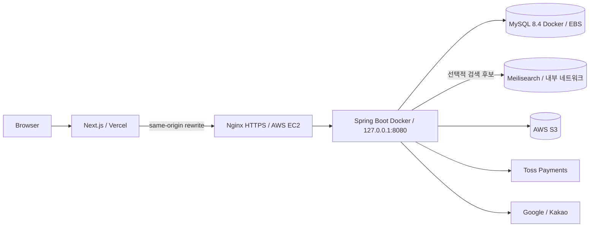

# Gift Market

> 주문·결제·배송·클레임·판매자 정산까지 거래의 전체 생명주기를 연결한 멀티셀러 커머스 서비스

Gift Market은 카카오톡 선물하기와 오픈마켓의 서비스 흐름을 참고해 개발한 개인 프로젝트입니다.
단순한 쇼핑몰 CRUD보다 **결제 결과 유실, 멀티셀러 주문, 재고·환불 정합성, Refresh Token 동시성, 반품·교환, Ledger 기반 정산**처럼 실제 거래 시스템에서 발생하는 문제를 직접 설계하고 해결하는 데 초점을 맞췄습니다.

## 서비스 링크

- **Service**: https://gift-market-test.vercel.app
- **Backend API**: Vercel same-origin rewrite를 통해 AWS Backend로 연결
- **Repository**: https://github.com/bys96/gift-market

> 현재 배포 환경은 포트폴리오 및 기능 검증을 위한 테스트 환경입니다.

> 2026-11-09 소스·문서 대조 기준입니다. 아래 기능 목록은 구현 범위이며 운영 E2E 완료를 뜻하지 않습니다. 상태는 [개발 현황](./docs/DEVELOPMENT_STATUS.md), 남은 검증은 [로드맵](./docs/ROADMAP.md)에서 구분합니다. 이번 문서 점검에서는 테스트·빌드·운영 접속을 수행하지 않았습니다.

---

## 프로젝트 개요

- **개발 형태**: 개인 프로젝트
- **개발 기간**: 2026-07-20 ~ 진행 중
- **담당 범위**: 요구사항 정의, 도메인/DB/API 설계, Frontend, Backend, 외부 API 연동, 배포

### 핵심 기술 과제

| 영역          | 문제                                 | 적용 방식                                                 |
| ------------- | ------------------------------------ | --------------------------------------------------------- |
| 멀티셀러 주문 | 판매자별 배송·취소·정산 독립 처리    | `Order → SellerOrder → OrderItem`, `Shipment 1:N`         |
| 결제          | PG와 내부 DB 상태 불일치             | 멱등성 Key, `CONFIRMING`, Provider 재조회, reconciliation |
| 인증          | 동시 Refresh 요청 충돌               | DB 비관적 잠금, previous token grace                      |
| 클레임        | 부분 취소·반품·교환의 수량·환불 충돌 | DB Lock, Snapshot, 환불 예약액 검증                       |
| 정산          | 과거 확정 정산 훼손 방지             | `SettlementLedgerEntry` 기반 증분 원장                    |

---

## 주요 기능

### 인증 / 사용자

- Google OIDC / Kakao OAuth2 로그인
- JWT Access Token + HttpOnly Refresh Token
- Refresh Token Rotation 및 동시 갱신 제어
- 프로필 / 배송지 / 회원 탈퇴·익명화
- `USER / SELLER / ADMIN / SUPER_ADMIN` 역할 분리

### 상품 / 판매자

- 판매자 신청 및 관리자 승인·거절
- `SellerStore` 상점 정보·로고·배너·고객센터 설정
- 상품 / 옵션 그룹 / Variant / 옵션별 재고 관리
- S3 Presigned URL 기반 이미지·동영상 업로드
- Tiptap 기반 상품 상세 편집
- 검색 / 카테고리 / 필터 / 찜 / 문의 / 리뷰
- 선택적 Meilisearch 검색·한국어 공통 동의어·관리자 인덱스/설정 관리, MySQL 기본 검색 및 fallback
- 추천 검색어만 표시하는 자동완성, `/products?keyword=…` 기반 PC·모바일 헤더 동기화와 다른 페이지 이동 시 초기화

선물 상황 분류와 일반 주문의 수령인·주소 입력은 구현되어 있습니다. 선물 전용 전달 링크·수락/거절·수신자 주소 입력·만료 흐름은 현재 미구현이며 일반 배송과 구분합니다.

### 주문 / 결제 / 클레임

- 장바구니·바로구매 및 판매자별 `SellerOrder` 분리
- 주문 시점 상품·옵션·가격·배송비 Snapshot
- 옵션 재고 예약·차감·복원
- Toss Payments 승인 / 조회 / 전체·부분 취소
- 주문 준비 및 PG 요청 멱등성
- 결제 결과 유실 시 Provider 재조회 및 reconciliation
- 전체·부분 취소 / 반품 / 교환 / 교환배송비 결제
- 최초배송·반품회수·교환회수·교환재배송 이력 분리

### 알림 / 정산

- `BUYER / SELLER / ADMIN` Context별 알림
- Transaction commit 이후 알림 저장
- 판매자별 `SettlementLedgerEntry`
- 매출 / 배송비 / 수수료 / 취소 / 반품 / 수수료 환입 기록
- `READY / ON_HOLD / CONFIRMED` 정산 상태 관리
- 확정 정산 불변성 및 이후 환불의 다음 회차 반영

> 현재 Settlement는 **정산 금액 확정**까지 담당하며 실제 판매자 계좌 지급(Payout)은 후속 도메인으로 계획하고 있습니다.

### Seller / Admin 운영

- Seller Center의 상품·주문·배송·취소·반품·교환·문의·알림·정산 관리
- Admin Center의 회원·판매자·상품 제재, 거래 조회, 판매자 신청, 알림·정산 관리
- `SUPER_ADMIN` 전용 관리자 권한 부여·회수와 변경 이력

---

## 기술 스택

| 영역               | 기술                                                                          |
| ------------------ | ----------------------------------------------------------------------------- |
| Frontend           | Next.js 16, React 19, TypeScript, Zustand, 일반 CSS, Tiptap 3                 |
| Backend            | Java 21, Spring Boot 4, Spring Security, OAuth2 Client, Spring Data JPA, JJWT |
| Database / Storage | MySQL 8.4, H2(Test), Amazon S3(Production), MinIO(Local)                      |
| External           | Toss Payments, Google OAuth, Kakao OAuth                                      |
| 검색 | Meilisearch v1.16.0, UTF-8 한국어 동의어, MySQL fallback |
| Infra              | Vercel, GitHub Actions(OIDC/SSM), AWS EC2, Nginx, Docker Compose, EBS |

---

## 아키텍처



Production은 Vercel의 `/api`, `/oauth2`, `/login/oauth2` rewrite를 유지해 브라우저 요청을 same-origin으로 처리합니다. Nginx가 HTTPS termination과 HTTP redirect를 담당하고 Spring Boot `8080`은 host loopback에만, MySQL `3306`은 Docker internal network에만 노출하는 구조입니다. MySQL 데이터는 Docker named volume/EBS에 영속되며 Production Hibernate는 `ddl-auto=validate`와 검토된 수동 SQL을 사용합니다. 04:00 KST S3 백업·14일 보관·분리 MySQL 복원 성공은 기존 운영 기록이며 현재 실행 상태는 확인 필요입니다. Versioned migration은 후속 과제입니다.

### 배포 책임

- **GitHub Actions → EC2 API**: [deploy-api.yml](./.github/workflows/deploy-api.yml)은 main의 `giftmarket-api/**` 변경 또는 수동 실행으로 AWS OIDC/SSM을 통해 저장소 밖 `deploy-api.sh`를 호출합니다. 워크플로 자체에 테스트 단계는 없고 Dockerfile의 JAR 생성도 테스트를 제외하므로 원격 스크립트의 테스트·health·롤백 게이트를 별도로 확인해야 합니다.
- **Vercel → Frontend**: Next.js 빌드·배포와 Backend rewrite를 담당합니다. API Actions가 Vercel을 배포하지 않습니다. 실제 Git 연동 branch/root/build 설정과 최신 배포 commit은 Vercel에서 확인해야 합니다.
- **Meilisearch**: [compose.search.yaml](./compose.search.yaml)은 별도 opt-in 검색 stack입니다. 저장소에는 API/MySQL 운영 Compose·EC2 배포/백업 스크립트가 없으므로 검색 네트워크 연결과 반영 여부를 추정하지 않습니다. 검색 설정·사전 변경은 [운영 문서](./docs/MEILISEARCH_OPERATIONS.md)를 따릅니다.
- Gemini 임베딩 검색 경로와 관련 의존성은 현재 실행 소스에 없습니다. 기존 검색 API 계약과 MySQL fallback은 유지되며, 과거 운영 임베딩 데이터 정리 여부는 별도 확인 대상입니다.

### 거래 구조

```text
Order
├─ SellerOrder N
│  ├─ OrderItem N
│  ├─ Shipment N
│  ├─ OrderCancellation N
│  ├─ ReturnRequest N
│  └─ ExchangeRequest N
└─ Payment N
   └─ PaymentCancellation N

Seller
├─ SellerStore
├─ Settlement N
└─ SettlementLedgerEntry N
```

---

## 핵심 구현

### 1. 멀티셀러 주문을 `Order → SellerOrder → OrderItem`으로 분리

구매자의 전체 주문과 판매자별 실제 이행 단위를 분리했습니다.

- `Order`: 구매자 관점의 전체 주문·결제
- `SellerOrder`: 판매자별 배송·취소·클레임·정산 단위
- `OrderItem`: 주문 시점 상품·옵션·가격 Snapshot
- `Shipment 1:N`: 최초배송 / 반품회수 / 교환회수 / 교환재배송 이력

한 판매자의 배송이나 클레임이 다른 판매자의 거래를 불필요하게 변경하지 않도록 구성했습니다.

### 2. 결제 결과 유실을 전제로 멱등성과 복구 흐름 설계

Toss Payments와 내부 DB는 하나의 ACID Transaction으로 묶을 수 없기 때문에 HTTP 오류를 곧바로 결제 실패로 확정하지 않았습니다.

```text
READY → CONFIRMING → PAID
          ↓
   Provider 재조회
          ↓
    reconciliation
```

- 외부 PG 호출을 DB Transaction 밖에서 수행
- 주문 준비 / PG 요청에 idempotency key 사용
- timeout·5xx·응답 유실은 `CONFIRMING` 상태에서 재조회
- callback의 브라우저 상태가 유실돼도 `merchantPaymentId`로 서버 Payment 복구
- 서버의 영속 Payment 상태를 Source of Truth로 사용

### 3. 부분 취소·반품·교환의 수량·재고·환불 정합성 보장

부분 Claim에서는 주문 수량뿐 아니라 이미 처리된 수량과 진행 중 요청이 점유한 수량을 함께 계산합니다.

```text
반품 가능 수량
= 주문 수량 - 취소/완료 반품/완료 교환/구매확정 수량
  - 진행 중 반품/교환 요청 수량

환불 가능 금액
= 결제 금액 - 완료 환불액 - 처리 중 환불 예약액
```

관련 주문 데이터를 Lock한 뒤 DB 값을 다시 검증하고, 재고 reservation / release / restore를 Claim 상태 전이에 맞춰 처리했습니다.

### 4. Refresh Token Rotation 동시성 제어

동시에 여러 API가 401을 반환해 Refresh 요청이 겹치는 상황을 고려했습니다.

- Refresh Token Row 조회 시 `PESSIMISTIC_WRITE` Lock
- Current Token은 Rotation, Previous Token은 짧은 grace 경로로 처리
- Raw Token은 SHA-256 Hash로 비교
- Frontend 인증 초기화는 공유 Promise로 중복 Refresh 감소

### 5. 현재 주문 상태가 아닌 Ledger를 기준으로 정산

확정된 과거 정산이 이후 취소·반품 때문에 변경되지 않도록 거래 이벤트별 정산 원장을 남깁니다.

```text
결제 성공  → SALE_PRODUCT + / SALE_SHIPPING + / COMMISSION -
취소·반품 → REFUND - / COMMISSION_REVERSAL +
```

`CONFIRMED` Settlement는 수정하지 않고, 이후 환불은 다음 정산 회차에 음수 Ledger로 반영합니다.

> 상세 설계는 [`PAYMENT_ARCHITECTURE_DESIGN.md`](./docs/PAYMENT_ARCHITECTURE_DESIGN.md), [`SETTLEMENT_V1.md`](./docs/SETTLEMENT_V1.md)에서 확인할 수 있습니다.

---

## 문제 해결 기록

### 1. Toss 부분취소 결과가 불명확한 문제

- **문제**: timeout·5xx·응답 유실 시 실제 PG 취소 성공 여부를 알 수 없음
- **해결**: 불명확한 요청은 `PaymentCancellation REQUESTED`로 유지하고 Provider 거래를 재조회
- **결과**: 네트워크 오류를 실제 실패와 분리해 중복 환불 위험 감소

### 2. 결제 재시도 시 오래된 주문 Snapshot 재사용

- **문제**: 결제창 종료 후 배송지·상품 조건이 변경돼도 기존 READY 주문이 재사용될 수 있음
- **해결**: 재결제 전 Snapshot 재검증, 조건 변경 시 기존 주문 취소 및 예약 재고 복원 후 재생성
- **결과**: 멱등성을 유지하면서 오래된 주문 정보로 결제되는 문제 방지

### 3. 운영 DB Timestamp가 KST보다 9시간 뒤로 저장

- **원인**: JVM / JDBC / MySQL Session timezone 불일치
- **해결**: JVM `Asia/Seoul`, JDBC `connectionTimeZone=+09:00`, Session timezone 강제 적용
- **결과**: PG timestamp와 애플리케이션 생성 시각을 동일한 KST 기준으로 통일

> 수수료 절삭 오차, AWS 이전, 과거 Render Startup 개선 등 추가 사례는 [`docs/TROUBLESHOOTING.md`](./docs/TROUBLESHOOTING.md)에 정리했습니다.

---

## 테스트

상태 전이와 동시성 문제가 많은 거래 도메인을 중심으로 테스트했습니다.

- 주문 생성 / Snapshot / 재고 예약
- 결제 승인·만료·reconciliation
- 전체·부분 취소 / 반품 / 교환
- Refresh Token Rotation
- Settlement Ledger 생성·집계·상태 변경
- Admin / Seller 권한 및 운영 기능

```bash
# Backend
cd giftmarket-api
./gradlew test

# Frontend
cd ../giftmarket-web
npm run lint
npx tsc --noEmit
npm run build

# Frontend Node 회귀
node --test tests/*.test.mjs
```

Docker 기반 검증은 Backend의 `./gradlew meiliIntegrationTest`, `./gradlew mysqlIntegrationTest`로 별도 실행합니다. 기본 `test`는 두 컨테이너 태그를 제외합니다. 같은 `test` 작업을 병렬 실행해 결과 폴더를 공유하지 않습니다. Windows PowerShell에서 실행 정책에 막히면 `npm.cmd`, `npx.cmd`를 사용합니다.

2026-11-06 Backend 전체·Meilisearch 검증 및 헤더 수정 당시 Frontend 검색 테스트·lint·타입 검사·빌드 성공 기록이 있습니다. Frontend 전체 Node 테스트에는 기존 로그인 테스트의 `isLoggingOut` 미정의 실패가 남아 있습니다. 이번 문서 작업에서 재실행하지 않았으며 상세 기록은 [개발 현황](./docs/DEVELOPMENT_STATUS.md)을 따릅니다.

---

## 프로젝트 구조

```text
gift-market
├── giftmarket-api
│   └── src/main/java/com/giftmarket
│       ├── auth
│       ├── order           # Order / SellerOrder / Shipment / Claim
│       ├── payment         # Payment / Cancellation / Reconciliation
│       ├── product
│       ├── seller
│       ├── settlement      # Settlement / Ledger
│       ├── notification
│       ├── admin
│       └── global
│           └── storage     # AWS S3 / local MinIO abstraction
│
├── giftmarket-web
│   ├── app                 # buyer / seller / admin routes
│   ├── components
│   ├── lib
│   ├── stores
│   ├── tests
│   └── types
│
└── docs                    # 상세 설계 / 트러블슈팅 / 로드맵
```

---

## 문서 안내

| 문서                                                                        | 내용                            |
| --------------------------------------------------------------------------- | ------------------------------- |
| [`DEVELOPMENT_STATUS.md`](./docs/DEVELOPMENT_STATUS.md)                     | 현재 구현·미구현 범위           |
| [`PAYMENT_ARCHITECTURE_DESIGN.md`](./docs/PAYMENT_ARCHITECTURE_DESIGN.md)   | 결제 상태·멱등성·reconciliation |
| [`ORDER_RETURN_EXCHANGE_DESIGN.md`](./docs/ORDER_RETURN_EXCHANGE_DESIGN.md) | 취소·반품·교환 정책             |
| [`SETTLEMENT_V1.md`](./docs/SETTLEMENT_V1.md)                               | Ledger 기반 정산 설계           |
| [`TROUBLESHOOTING.md`](./docs/TROUBLESHOOTING.md)                           | 실제 문제·원인·해결 기록        |
| [`ROADMAP.md`](./docs/ROADMAP.md)                                           | 후속 개발 계획                  |
| [`MEILISEARCH_OPERATIONS.md`](./docs/MEILISEARCH_OPERATIONS.md) | 검색 설정·동의어·동기화·관리 API |
| [`SEARCH_VERIFICATION.md`](./docs/SEARCH_VERIFICATION.md) | 검색·자동완성·헤더 URL 검증 범위 |
| [`ORDER_CANCELLATION_REFUND_DESIGN.md`](./docs/ORDER_CANCELLATION_REFUND_DESIGN.md) | 부분 취소·환불 정책 |
| [`NOTIFICATION_DESIGN.md`](./docs/NOTIFICATION_DESIGN.md) | 알림·권한·API |
| [`PRODUCT_DESCRIPTION_MEDIA.md`](./docs/PRODUCT_DESCRIPTION_MEDIA.md) | 상세 미디어 저장·업로드·운영 확인 |
| [`admin-operation-policy.md`](./docs/admin-operation-policy.md) | 관리자 운영·권한 경계 |

> 문서와 코드가 충돌하는 경우 현재 구현 코드를 최종 기준으로 합니다.

---

## 개발 환경 시작

### Backend

Java 21, MySQL이 필요합니다. 로컬 Object Storage는 MinIO를 사용할 수 있고 Production은 AWS S3를 사용합니다.

```bash
git clone https://github.com/bys96/gift-market.git
cd gift-market/giftmarket-api
cp src/main/resources/application-example.yaml src/main/resources/application.yaml
./gradlew bootRun
```

주요 환경변수는 아래 이름에 맞춰 로컬/배포 환경에 주입합니다. 실제 값은 문서나 저장소에 기록하지 않습니다. `application-example.yaml`의 Aiven 주석과 `.env.sample`의 Render 예시는 현재 운영 인프라를 뜻하지 않습니다.

### Frontend

```bash
cd ../giftmarket-web
cp .env.sample .env.local
npm ci
npm run dev
```

> Secret 값은 Repository에 포함하지 않습니다.

| 변수명 | 용도 |
| --- | --- |
| `DB_URL`, `DB_USERNAME`, `DB_PASSWORD`, `JPA_DDL_AUTO` | MySQL 연결·스키마 검사. 운영은 validate |
| `GOOGLE_CLIENT_ID`, `GOOGLE_CLIENT_SECRET`, `KAKAO_CLIENT_ID`, `KAKAO_CLIENT_SECRET` | OAuth Provider 등록 정보 |
| `SPRING_SECURITY_OAUTH2_CLIENT_REGISTRATION_GOOGLE_REDIRECT_URI`, `SPRING_SECURITY_OAUTH2_CLIENT_REGISTRATION_KAKAO_REDIRECT_URI` | 필요한 경우 Vercel 경유 callback 주소 명시 |
| `JWT_SECRET`, `REFRESH_TOKEN_ENCRYPTION_KEY` | JWT 서명과 refresh 암호화 키 분리 |
| `FRONTEND_URL`, `FORWARD_HEADERS_STRATEGY`, `REFRESH_COOKIE_SECURE`, `REFRESH_COOKIE_SAME_SITE` | 인증 redirect·proxy·cookie 설정 |
| `STORAGE_PROVIDER`, `S3_REGION`, `S3_BUCKET`, `S3_ACCESS_KEY`, `S3_SECRET_KEY` | S3 Provider·버킷·인증 설정 |
| `MINIO_ENDPOINT`, `MINIO_BUCKET`, `MINIO_ACCESS_KEY`, `MINIO_SECRET_KEY` | 로컬 MinIO Provider 설정 |
| `TOSS_SECRET_KEY`, `NEXT_PUBLIC_TOSS_CLIENT_KEY` | 서버 PG 인증 / 브라우저 결제창 식별자 |
| `SEARCH_ENGINE`, `SEARCH_INDEXING_ENABLED`, `SEARCH_URL`, `SEARCH_API_KEY`, `SEARCH_INDEX`, `SEARCH_SYNONYMS_LOCATION` | 엔진·인덱싱·서버 연결·인덱스·사전. sample의 별칭 `MEILI_URL`, `MEILI_API_KEY`와 구분 |
| `MEILI_MASTER_KEY` | 검색 Compose의 서버 인증 키. 브라우저 공개 금지 |
| `BACKEND_API_ORIGIN` | Vercel 서버의 AWS HTTPS rewrite 대상 |
| `NEXT_PUBLIC_API_BASE_URL` | 로컬 직접 API 주소. 운영 same-origin 구조에서는 비우거나 미설정 |
| `NEXT_PUBLIC_STORAGE_BASE_URL` | 공개 미디어 origin. 변경 후 Frontend 재배포 |
| `SETTLEMENT_HOLD_DAYS`, `SETTLEMENT_COMMISSION_RATE_BPS` | 정산 유예일·수수료율 |
| `AWS_DEPLOY_ROLE_ARN`, `AWS_EC2_INSTANCE_ID` | GitHub Actions 변수: OIDC 역할·SSM 대상. 런타임 애플리케이션 secret과 별개 |

---

## 개발 범위

개인 프로젝트로 전체 개발을 담당했습니다.

- 도메인 / DB / REST API 설계
- OAuth2 / JWT 인증 및 동시성 처리
- 상품·재고 / 주문·결제·배송 / 취소·반품·교환
- Seller Center / Admin Center / Notification / Settlement
- S3·MinIO Storage / Toss Payments 연동
- Vercel Frontend와 AWS EC2·Nginx·Docker 기반 Backend/MySQL 운영

---

## 로드맵

출시 준비 우선순위는 주문·결제 E2E, 선물하기 정책·미구현 수신자 흐름, 관리자·판매자 운영, 인증·보안, 배포·모니터링·백업 점검 순입니다. 이후 모바일 실기기 UX를 개선합니다. 구현된 선물 상황·Meilisearch·자동완성·헤더 URL 동기화는 재개발 대상이 아닙니다. 추천 고도화, 쿠폰·포인트, Seller Review 답글, Settlement Scheduler, Payout, versioned migration은 별도 후속 범위입니다. [개발 현황](docs/DEVELOPMENT_STATUS.md)과 [로드맵](docs/ROADMAP.md)을 확인하세요.

자세한 내용은 [`docs/ROADMAP.md`](./docs/ROADMAP.md)를 참고합니다.

---

## 라이선스

This project is licensed under the [MIT License](./LICENSE).
