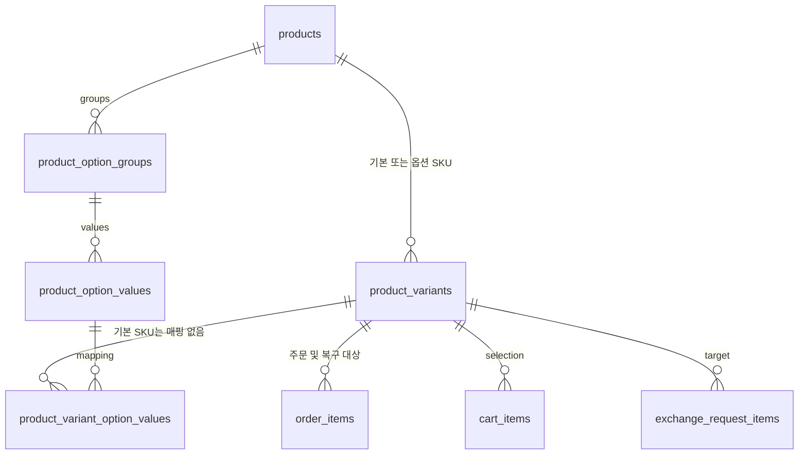

# 무옵션 내부 SKU 통합 보고서

2026-11-17. 운영 DB 접속·SQL 실행·배포·커밋·푸시는 수행하지 않았다. 기존 SKU 문서의 Product/Variant 소유권 고정 및 무옵션→옵션 전환 금지 정책을 이 문서로 대체한다. 기존 결제·취소·반품·교환 업무와 결과 대사/idempotency 정책은 유지한다.

## ERD와 재고 구조



기존 무옵션 재고 원장은 Product, 옵션 재고 원장은 Variant였다. 이제 신규/이관 무옵션도 기본 Variant를 사용하고 Product.stockQuantity는 활성 Variant 합계 캐시다. 테이블·컬럼·기존 FK/ID/UNIQUE를 유지하며 새 DDL은 없다.

- 기본 Variant는 `combination_key='__DEFAULT__'`, 추가금 0, 옵션 매핑 없음. 기존 `(product_id, combination_key)` UNIQUE가 상품별 최대 1개를 보장하고 정상 생성/이관에서 정확히 1개를 만든다. 일반 key는 양의 `groupId:valueId` 조합이라 구분된다.
- 기본 시스템 SKU는 기존 `GM-{UUID}` 규칙, 판매자 코드는 `DEFAULT-{productId}`. 기존 trim/대문자 정규화·상품 내 UNIQUE를 적용하며 전환 후에도 코드를 점유한다.
- 신규 옵션 상품의 통합 등록은 실제 옵션 Variant만 생성한다. 기존 옵션 상품은 이관 대상이 아니며 ID·SKU·재고를 바꾸지 않는다.
- 구매자 `hasOptions`와 판매자 `variantManaged`는 일반 옵션 Variant 이력 기준이다. 기본 SKU는 옵션 목록에서 제외한다. 옵션 전체 보관 후 무옵션으로 돌아가지 않는다.
- 무옵션의 옵션 snapshot은 계속 NULL이다. 결제 준비 때 한 번 예약 차감하고 결제 승인에서 재차 차감하지 않는다.

## 안전한 전환 정책

기본 SKU를 비활성화하고 ID·SKU·잔여 재고를 **별도 보관**한다. 새 옵션 재고는 기존 보관 재고 및 주문 예약분을 제외한 별도 실물을 확인해 각각 입력한다. 기본 재고 자동 배분·삭제·다른 옵션 연결·재활성화는 하지 않는다. 전환 전 주문의 취소/반품 복구도 기본 SKU 보관 재고로만 들어가므로 새 옵션 가용 재고는 증가하지 않는다.

판매자 화면은 보관 수량, 전환 후 복구 정책, 명시 동의 체크박스, 차단 사유와 조건 재조회 버튼을 제공한다. 전환 후 보관 수량도 옵션 편집 화면에 표시한다. 보관 재고의 폐기·다른 SKU 이동 기능은 이번 범위가 아니다. 수동 DB 이동으로 대체하지 말고 필요한 경우 감사 이력을 포함한 재고 이동 원장을 후속 설계한다.

다음은 409로 차단한다:

- 기본 SKU 이관 미완료, 혼재 이력 또는 매핑 손상
- PENDING_PAYMENT 주문 존재: 결제 확인 중·결과 불명도 포함
- 종료되지 않은 교환 요청 존재: 요청부터 예약·배송비 결제·회수·재배송까지 포함
- `options.retainDefaultStock=true` 명시 동의 없음

PAID/배송 중 주문·취소/반품 요청은 기존 기본 SKU를 계속 참조하므로 전환을 허용한다. 구매/전환/복구는 Product→Variant 잠금으로 직렬화한다. 필요한 상품 수정·주문 생성 조회는 READ_COMMITTED를 사용한다. 재고 합계는 flush 후 활성 Variant 잠금 조회/refresh로 계산하고 복구 대상도 잠금 후 refresh하여 MySQL의 이전 스냅샷을 사용하지 않는다. 무옵션 재고 수정의 기존 Product 버전 계약과 Variant @Version을 유지한다.

기본 SKU 교환 신청도 Product 잠금을 사용하며 전환된 비활성 기본 SKU의 신규 예약을 막는다. 기존 NULL 교환 요청의 멱등 비교는 기본 target을 NULL로 정규화한다. 내부 Variant 도입을 이유로 기존 무옵션 구매자 귀책 교환 정책을 바꾸지 않는다.

## API 변경

새 URL은 없다. ApiResponse와 주문·결제 응답 형식을 유지한다.

| 기존 API | 변경 |
| --- | --- |
| `POST /api/seller/products`, `/registration` | 신규 무옵션 기본 Variant 자동 생성 |
| `GET /api/seller/products/{id}/variants` | 기본 SKU는 variants에서 제외. retainedDefaultStock, conversionAvailable, conversionBlockReason 추가 |
| `PUT /api/seller/products/{id}/modification` | options.retainDefaultStock 선택 필드 추가. 최초 전환에는 true 필수. 옵션·Variant와 한 transaction에서 저장 |
| `PUT /api/seller/products/{id}/options` | 같은 전환 조건 적용. 기존 별도 옵션/Variant API 유지. 통합 수정 API 사용 권장 |
| `PATCH /api/seller/products/{id}/stock` | stockQuantity/expectedVersion 계약 유지. 기본 Variant와 Product 캐시 동시 수정 |
| `GET /api/products/{id}` | 무옵션 hasOptions=false, 기본 SKU 옵션 목록 미노출 |
| `POST /api/cart/items`, `/bulk` | 기존 variantId=null 요청을 기본 Variant로 해석·병합 |
| `POST /api/orders/direct`, `/api/orders` | 기본 Variant로 예약·OrderItem 참조. NULL 요청, 기존 단일/다중 옵션 호환 |

바로구매는 명시한 기본 Variant ID도 해당 상품의 기본 ID일 때만 허용한다. 무옵션은 한 항목으로 수량을 합쳐야 하며 NULL/기본 ID를 이용한 중복 항목은 거부한다. 서버 가격·재고·판매 상태·소유권 검증을 유지한다.

## 수동 SQL 실행 순서

1. [사전/사후 SELECT](./sql/product-default-variant-checks.sql)
2. [옵션 매핑 대사 SELECT](./sql/product-sku-reconciliation.sql)
3. [이관 SQL](./sql/product-default-variant.sql)

운영자가 먼저 격리된 운영 백업 복원본에서 전체 절차를 검증한다.

1. 전체 DB 백업/복원 검증과 API/Web 배포본 보관. 기존 product-variant-seller-sku.sql 및 product-option-archive.sql의 컬럼/제약 적용 상태를 실제 SHOW CREATE TABLE로 확인한다. 이번 이관은 business table DDL이 없다.
2. API·scheduler·webhook·reconciliation·외부 writer를 모두 중단한다. 유지보수 중 webhook은 재시도/후속 대사 대상으로 보존한다. 구버전과 신버전을 함께 실행하지 않는다.
3. 두 SELECT 파일을 실행하고 결과를 안전한 운영 저장소에 보관한다. 매핑 손실·혼재 주문·음수 재고·합계 불일치·기본 SKU 예약값 손상·중복 장바구니·FK 소유권 이상이 있으면 중단하고 대상 ID/원인을 보고한다. 실패/취소 주문을 임의 제외하거나 자동 보정하지 않는다.
4. MySQL 클라이언트에서 이관 SQL을 실행한다. 프로시저 생성/실행 권한이 필요하다. DML은 한 transaction이며 실패 시 rollback+SIGNAL이다. 프로시저 DDL은 implicit commit이므로 외부 transaction rollback에 기대지 않는다. 오류 무시 `--force`를 사용하지 않는다. 실패 시 writer 중단을 유지한다.
5. 사후 미이관/NULL FK SELECT가 0건인지 확인한다. 기존 옵션 Variant 전체 행, 주문 snapshot/금액/누적 수량, 결제/취소/반품/교환 이력을 보관본과 대조한다. 신규 기본 Variant 및 NULL FK 연결만 달라야 한다. Product 재고/상태도 이관 중 바꾸지 않는다.
6. writer 중단 상태에서 이관 파일을 재실행해 ID·SKU·재고·FK·행 수가 같음을 확인한다. 이미 Variant가 있으면 INSERT 대상에서 제외하며 재고를 다시 더하지 않는다.
7. 새 API를 ddl-auto=validate로 기동하고 Web을 함께 전환한다. 무옵션/옵션 구매, 예약 만료, 과거 주문 취소/반품, 전환/409/UI 인수 후 writer를 재개하고 PG 지연 결과를 기존 reconciliation으로 대사한다.

SQL은 **현재 가용 재고만** 복사한다. 예약 차감분/누적 취소·반품 수량을 다시 더하지 않는다. 과거 order_items.variant_id, 교환 target_variant_id, 장바구니 variant_id의 NULL만 연결한다. 주문·결제·클레임 상태, snapshot, 금액, 누적 복원 수량은 바꾸지 않고 업무를 재실행하지 않는다. 이미 환불된 주문에서도 추가 복구가 발생하지 않는다.

과거 NULL 주문 복구 호환 경로는 기본 Variant가 있으면 그곳으로, 이관 전 상품이면 기존 Product로 복구한다. 목표 운영 상태는 전체 무옵션 이관 완료이며 SQL을 생략한 새 버전 단독 배포는 지원하지 않는다. 매핑이 사라진 일반 Variant를 기본 SKU로 추정하거나 옵션 이력이 있는 상품을 임의 분류하지 않는다. 실제 운영 데이터의 이상 유무는 조회하지 않았으므로 SELECT 결과가 운영 검토 근거다.

## 복구 제한

새 버전 쓰기 시작 후 구버전으로 단순 롤백할 수 없다. 구버전은 기본 Variant를 옵션으로 오해할 수 있다. writer를 중단하고 수정본으로 전진 복구한다. 백업 이후 어떤 writer도 실행되지 않았고 PG 신규 거래도 없다는 사실을 확인한 경우에만 운영자가 백업 복원을 별도 판단한다. 기본 Variant 삭제·기존 SKU 변경·FK NULL 역변환 SQL은 제공하지 않는다.

## 검증 결과

최종 검증 (2026-11-17):

- `giftmarket-api`: `gradlew test mysqlIntegrationTest --continue --no-daemon` 성공. 기본 전체 1,248개와 MySQL 8.4 통합 123개가 실패·오류·스킵 0으로 통과했다.
- `giftmarket-web`: `node --test tests/*.test.mjs` 122개 실패·스킵 0. `npm.cmd run lint`, `npx.cmd tsc --noEmit`, `npm.cmd run build` 성공. Windows PowerShell 실행 정책 때문에 npm/npx의 .cmd 실행 파일을 사용했다.
- `git diff --check` 통과. 빌드가 자동 수정한 next-env.d.ts는 작업 전 내용으로 복원하고 TypeScript를 재확인했다.

자동화 테스트는 운영 백업 이관 리허설·실제 Toss·PC/모바일 브라우저 인수를 대체하지 않는다. 운영 DB·외부 배포·커밋·푸시는 수행하지 않았다.

| 요구 검증 | 자동화 근거 |
| --- | --- |
| 1 신규 무옵션 기본 SKU | ProductStockIntegrationTest 생성 및 구매자/판매자 목록 비노출 |
| 2 이관/재실행 | DefaultVariantMigrationMySqlTest 실제 SQL 실행/재실행, 동일 ID·SKU·재고 |
| 3 기존 옵션 불변 | 동일 SQL 테스트의 기존 옵션 ID/SKU/재고/version/snapshot 대조 + 기존 옵션 회귀 |
| 4 기본 SKU 구매 차감 | MultiOptionPurchaseIntegrationTest 기본 직접구매/장바구니 주문 |
| 5 취소 복구 | 기본 SKU 미결제 취소 중복 요청 및 결제 후 환불 |
| 6 실패/만료 복구 | defaultSkuReservationsRestoreExactlyOnce의 failure/expiry 및 중복 결과 |
| 7 과거 NULL 주문 호환 | legacyNullOrderRestoresToDefaultAfterMigrationWithoutChangingSnapshot + SQL의 이미 취소된 주문 FK-only 이관 |
| 8 무옵션→옵션 | conversionRetainsDefaultIdentityAndStockWithoutAllocation |
| 9 전환 전 주문 환불 | paidOrderCanBeRefundedAfterConversionIntoRetainedDefaultOnly (gateway stub, 실제 업무/DB transaction) |
| 10 미처리/예약 보호 | 결제 대기 전환 차단·진행 중 교환 정책 guard·구매/전환 동시 실행 |
| 11 기존 다중 옵션 | 기존 MultiOptionPurchaseIntegrationTest 전체를 H2/MySQL에서 실행 |
| 12 초과 판매 | 서로 다른 두 구매자의 기본 SKU 마지막 재고 동시 주문 |
| 13 SKU/ID | 전환 전후 기본 ID/시스템 SKU 보존, 이관 재실행 및 기존 MySQL UNIQUE/보관 복원 회귀 |
| 14 판매자 동시 수정 | competingDefaultStockEditsRejectTheStaleSellerVersion 및 기존 옵션 version 회귀 |

MySQL에서는 DefaultVariantMySqlIntegrationTest가 같은 구매/복구/전환/동시성 시나리오를 실제 MySQL 8.4 격리 컨테이너에서 실행한다. 진행 중 교환의 차단 사유는 정책 단위 테스트이며 기존 전체 MySQL 교환 예약 workflow 테스트와 함께 검증한다. 실제 운영 데이터·PG·실기기 인수 완료를 의미하지 않는다.

## 변경 파일

Backend `giftmarket-api/src/main/java/com/giftmarket/` 기준:

- product/entity/ProductVariant.java, product/repository/ProductVariantRepository.java
- product/service/ProductService.java, ProductRegistrationService.java, ProductModificationService.java
- product/service/ProductInventoryPolicy.java, ProductVariantMapping.java, ProductOptionService.java, ProductVariantService.java
- product/dto/request/ProductOptionUpdateRequest.java
- product/dto/response/ProductDetailResponse.java, ProductVariantListResponse.java
- cart/service/CartService.java, order/service/OrderService.java
- order/service/OrderInventoryService.java, ExchangeRequestService.java, order/repository/OrderItemRepository.java

Frontend `giftmarket-web/` 기준:

- components/seller/ProductForm.tsx, ProductOptionManager.tsx, types/product.ts
- app/admin/(admin-center)/products/[productId]/page.tsx: 내부 기본 SKU 표시와 무옵션 판별
- tests/default-variant-conversion.test.mjs

Backend 테스트:

- product/service/ProductStockIntegrationTest.java, ProductVariantServiceTest.java, DefaultVariantPolicyTest.java
- product/service/DefaultVariantMigrationMySqlTest.java: 실제 SQL 실행/재실행, 기존 옵션/주문 보존 및 불일치 rollback
- order/integration/MultiOptionPurchaseIntegrationTest.java, DefaultVariantMySqlIntegrationTest.java: 기본 SKU 주문/장바구니/실패/만료/전환 후 환불/동시 주문·재고 수정·전환 경쟁과 기존 다중 옵션 회귀
- order/service/ExchangeRequestServiceTest.java, OrderInventoryServiceTest.java

문서/SQL: 이 보고서, DEVELOPMENT_STATUS.md, SKU_DESIGN.md, sql/product-default-variant.sql, sql/product-default-variant-checks.sql, sql/product-sku-reconciliation.sql.

## 2026-11-18 SQL 최종 안전성 검토

이번 검토는 두 이관/검증 SQL과 관련 MySQL 테스트만 보강했다. 백엔드 운영 코드·Frontend는 추가 수정하지 않았다. 운영 DB 접속/실행·배포·커밋·푸시는 하지 않았다.

발견 및 수정:

- 실제 DB에 필요한 UNIQUE/FK가 있는지 확인하지 않던 부분을 보강했다. 기본 SKU 중복(비활성 포함)을 상품/Variant ID로 식별하고, 전체 컬럼 UNIQUE 3개 및 Product/Variant FK 4개를 메타데이터로 검증한다. 제약 이름은 달라도 허용하지만 prefix/추가 컬럼 UNIQUE는 대체 제약으로 인정하지 않는다. 누락 시 자동 DDL 없이 중단한다.
- INNER JOIN이 누락시키던 고아 Product/Variant/OrderItem 참조를 LEFT JOIN으로 검출한다. 잘못된 소유권·기본/옵션 SKU가 혼재한 교환·기본 SKU에 옵션 snapshot이 붙은 주문/교환도 차단한다.
- 느슨한 UUID 패턴, 기본 key/판매자 코드의 대소문자 혼동, 옵션 이력과 동시에 활성인 기본 SKU, NULL 식별자/상태를 식별한다. 기본 SKU와 일반 옵션 매핑 손상도 검증 SQL에서 직접 ID와 사유로 조회한다.
- InnoDB/FK 검사 활성 여부 및 trigger/자동 ON UPDATE 부작용을 확인한다. SQL 경고도 rollback 처리한다. 기존 데이터의 자동 보정·병합·삭제는 하지 않는다.
- 상품별 재고/상태/version/시각, 기존 Variant 전체 행, 주문·장바구니·교환/반품 항목의 비교용 조회를 추가했다. 중복 ID는 GROUP_CONCAT 대신 개별 행으로 출력해 잘림을 피한다. baseline 조회와 이상 조회, AFTER 전용 조회를 구분했다.

최종 검증:

```text
gradlew mysqlIntegrationTest
  --tests com.giftmarket.product.service.DefaultVariantMigrationMySqlTest
  --tests com.giftmarket.product.service.DefaultVariantJpaMigrationMySqlTest
  --no-daemon
```

격리 MySQL 8.4에서 **23개 통과, 실패·오류·스킵 0**. 축약 스키마의 실패/재실행 사례 22개와 실제 Hibernate/JPA DDL·엔티티 기반 검증 1개다. 두 SQL 파일의 모든 SELECT와 프로시저를 실제 실행했고, 정상 데이터의 이상 조회는 0건임을 확인했다. 참조를 의도적으로 깨뜨린 경우 정확한 교환 항목 ID가 진단되는 것도 검증했다.

상품 전체 컬럼·활성/비활성 기존 Variant 전체 컬럼·주문 snapshot/금액/누적 수량·결제/환불/취소/반품 이력은 전후 동일하다. 허용한 변경은 신규 기본 Variant와 기존 NULL Variant FK 3종의 연결뿐이다. 재실행 및 옵션 전환 이후 재실행에서도 동일 ID/SKU/재고를 유지한다. 마지막 장바구니 UPDATE에 제약 실패를 강제해 신규 Variant와 앞선 FK UPDATE까지 함께 rollback됨을 검증했다.

운영 적용 전제는 여전히 복원본 리허설, 모든 writer 중단, 외부 baseline 보관/대조다. 실행 계정에는 index/FK/trigger 메타데이터를 볼 권한(특히 TRIGGER)이 필요하다. 메타데이터 권한이 제한된 결과를 제약/trigger 부재의 증거로 사용하지 않는다. 프로시저 DDL은 implicit commit이므로 미완료 transaction이 없는 전용 연결에서 실행한다.

MySQL 8.4 근거: [STATISTICS의 NON_UNIQUE/SUB_PART](https://dev.mysql.com/doc/refman/8.4/en/information-schema-statistics-table.html), [DDL implicit commit](https://dev.mysql.com/doc/refman/8.4/en/implicit-commit.html).
